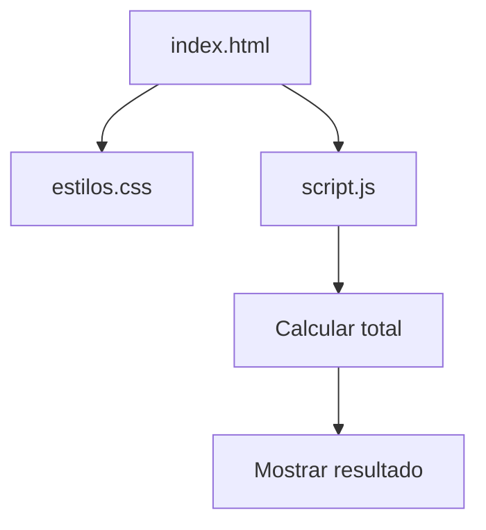

# 🛒 Tienda TECSUP

Proyecto de práctica del Laboratorio 03 del curso Diseño de Interfaces de Programación Avanzado de TECSUP.

## 📑 Tabla de contenidos

- [Descripción](#descripción)
- [Uso](#uso)
- [Tecnologías](#tecnologías)
- [Arquitectura](#arquitectura)
- [Contribución](#contribución)

## 📌 Descripción

Tienda TECSUP es una aplicación web sencilla que muestra productos, sus precios y cantidades, y calcula el importe total de la compra.

## 🚀 Uso

1. Clonar el repositorio.
2. Abrir el archivo `index.html` en un navegador.
3. Visualizar los productos y el total calculado.

No requiere instalación de dependencias.

## 🛠️ Tecnologías

- HTML5
- CSS3
- JavaScript

## 🏗️ Arquitectura

El proyecto utiliza una estructura sencilla:

- `index.html`: estructura de la página.
- `estilos.css`: estilos visuales.
- `script.js`: lógica de cálculo del total.

## 🤝 Contribución

Lee la [guía de contribución](CONTRIBUTING.md) antes de enviar cambios.
