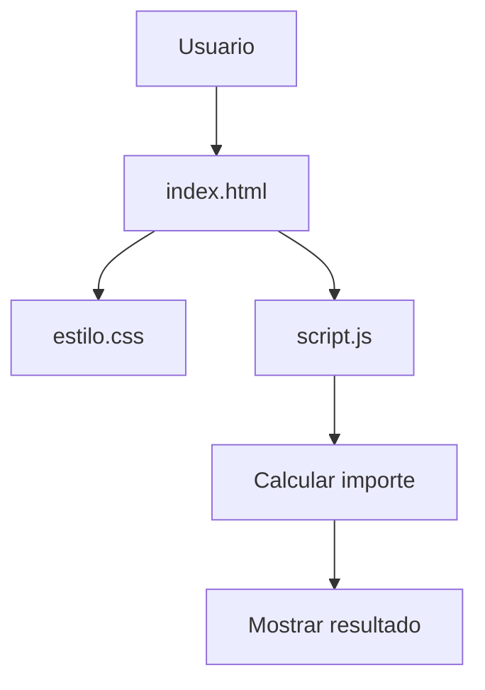

# 🛒 Tienda TECSUP


Proyecto de práctica del Laboratorio 03 del curso Diseño Avanzado de Interfaces de Programación de TECSUP.
Aplicación web que muestra productos, precios, cantidades y el importe de compra.

## 📑 Tabla de contenidos

- [Descripción](#descripción)
- [Instalación](#instalación)
- [Uso](#uso)
- [Tecnologías](#tecnologías)
- [Estado de las funciones](#estado-de-las-funciones)
- [Hoja de ruta](#hoja-de-ruta)
- [Ejemplos de código](#ejemplos-de-código)
- [Arquitectura](#arquitectura)
- [Contribución](#contribución)
- [Autor](#autor)

## 📌 Descripción

Tienda TECSUP es una aplicación web estática que presenta productos de ejemplo con sus precios y cantidades.

El proyecto utiliza HTML para la estructura, CSS para el diseño y JavaScript para calcular y mostrar el importe de los productos.

## 📥 Instalación

Clona el repositorio:

```bash
git clone https://github.com/MarkArellano1997/tienda.git
```

Ingresa a la carpeta:

```bash
cd tienda
```

No requiere instalación de dependencias ni servidor backend.

## 🚀 Uso

1. Clonar o descargar el repositorio.
2. Abrir la carpeta del proyecto.
3. Ejecutar `index.html` en un navegador web.
4. Visualizar los productos y el total calculado.

## 🛠️ Tecnologías

| Tecnología | Uso | Prioridad |
|:-----------|:---:|----------:|
| HTML5 | Estructura | Alta |
| CSS3 | Diseño visual | Alta |
| JavaScript | Cálculos | Alta |

## 📊 Estado de las funciones

| Función | Estado | Prioridad |
|:--------|:------:|----------:|
| Mostrar productos | Listo | Alta |
| Mostrar precios y cantidades | Listo | Alta |
| Calcular importe de productos | Listo | Alta |
| Agregar productos dinámicamente | Pendiente | Media |
| Implementar carrito interactivo | Pendiente | Alta |

## 🗺️ Hoja de ruta

- [x] Crear estructura HTML de la tienda
- [x] Diseñar tabla de productos
- [x] Implementar cálculo con JavaScript
- [x] Mostrar el importe en pantalla
- [ ] Permitir agregar nuevos productos
- [ ] Implementar carrito interactivo
- [ ] Mejorar diseño adaptable a dispositivos móviles

## 💻 Ejemplos de código

### Estructura HTML

```html
<table>
  <tr>
    <th>Producto</th>
    <th>Precio</th>
    <th>Cantidad</th>
  </tr>
  <tr>
    <td>Polo TECSUP</td>
    <td>S/ 25.00</td>
    <td>2</td>
  </tr>
</table>

<p id="total">Total: S/ 0.00</p>
```

### Cálculo con JavaScript

```js
const productos = [
  { nombre: "Polo TECSUP", precio: 25.00, cantidad: 2 },
  { nombre: "Taza TECSUP", precio: 18.00, cantidad: 1 }
];

function calcularTotal(lista) {
  let total = 0;

  for (const producto of lista) {
    total = total + producto.precio;
  }

  return total;
}
```

### Ejemplo de producto en JSON

```json
{
  "nombre": "Polo TECSUP",
  "precio": 25.00,
  "cantidad": 2
}
```

## 🏗️ Arquitectura

El proyecto está organizado en tres archivos principales:

- `index.html`: estructura y contenido.
- `estilo.css`: estilos visuales.
- `script.js`: lógica de cálculo.



## 🤝 Contribución

Lee la [guía de contribución](CONTRIBUTING.md) antes de proponer cambios.

## 👨‍💻 Autor

**Mark Arellano**

Proyecto académico desarrollado para TECSUP.
